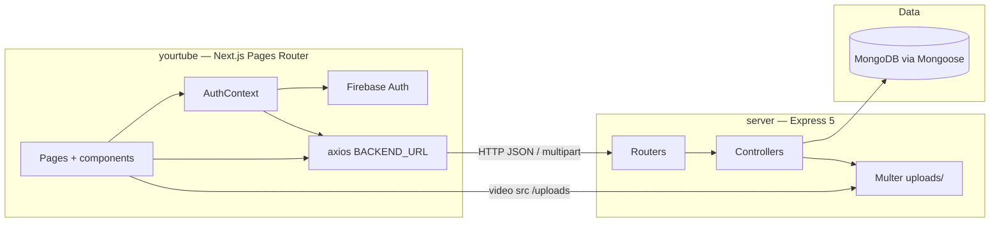
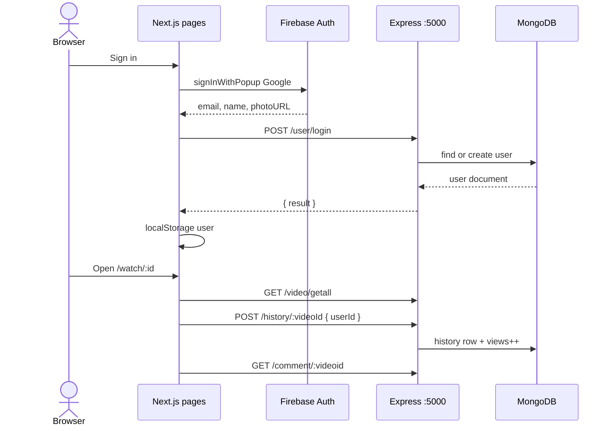
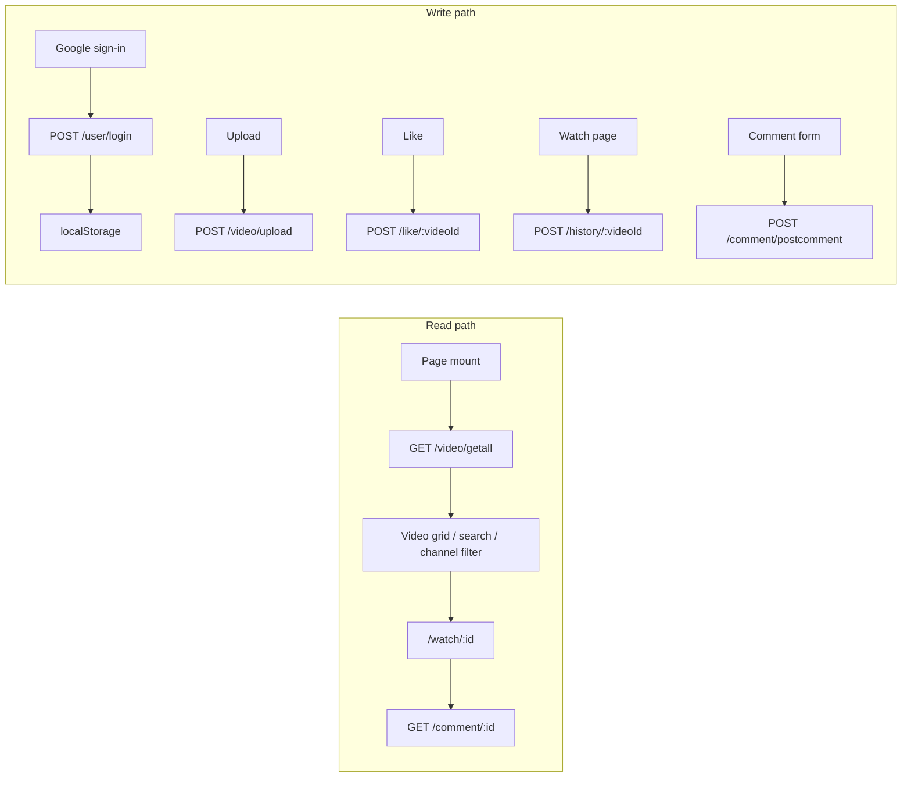

# YouTube Clone Architecture

**YourTube** — two-process clone: a Next.js client (`yourtube/`) and an Express API (`server/`). Media files live on the API disk. User identity starts in Firebase Auth (Google) and is upserted into MongoDB. There is no Prisma, Supabase, PostgreSQL, JWT middleware, App Router, or server actions in the current tree.

The current tree is a scaffold: the client home page renders **Hello youtube_clone**. Routes, models, and endpoints below are the target shape.

---

## 1. System overview





---

## 2. Technical stack

Versions are the ranges declared in `package.json`.

| Layer | Choice | Version |
| --- | --- | --- |
| Frontend framework | Next.js (Pages Router, `reactStrictMode`) | `15.3.3` |
| UI library | React / React DOM | `^19.0.0` |
| Language | TypeScript (strict, `jsx: preserve`, path `@/*`) | `^5` |
| CSS | Tailwind CSS v4 + `@tailwindcss/postcss` + `tw-animate-css` | `^4` / `^1.3.4` |
| Component system | shadcn/ui, style `new-york`, base `neutral`, CSS variables, icons `lucide` | template `next`, Pages Router, `rsc: false` |
| Class helpers | `clsx`, `tailwind-merge`, `class-variance-authority` | `^2.1.1` / `^3.3.0` / `^0.7.1` |
| Primitives | Radix Avatar, Dialog, Dropdown Menu, Label, Progress, Slot | see `yourtube/package.json` |
| Toasts / theme hook | `sonner`, `next-themes` | `^2.0.5` / `^0.4.6` |
| Icons / dates | `lucide-react`, `date-fns` | `^0.513.0` / `^4.1.0` |
| HTTP client | `axios` (`baseURL = BACKEND_URL`) | `^1.10.0` |
| Client auth | Firebase Auth, Google popup | `firebase ^11.9.1` |
| API | Express (ESM), `cors`, `dotenv`, `body-parser` | `express ^5.1.0` |
| Uploads | Multer disk storage, `video/mp4` only; `express-fileupload` installed, unused | `multer ^2.0.1` |
| Database | MongoDB + Mongoose. No Prisma, Supabase, or PostgreSQL. | `mongoose ^8.16.0` |
| Token lib | `jsonwebtoken` is a dependency and is not used. Routes are open. | `^9.0.2` |
| Process | `nodemon` via `npm start`, `PORT` or `5000` | `^3.1.10` |
| Deploy | None committed. Next is Vercel-shaped. Express + local `uploads/` needs a Node host with a persistent disk. | — |

**shadcn components to add as the UI grows:** `avatar`, `button`, `dialog`, `dropdown-menu`, `input`, `label`, `progress`, `sonner`, `textarea`.

**Not in this repo:** App Router (`app/`), React Server Components, Server Actions, route handlers under `app/api`, middleware, Prisma schema, Supabase client. A stub may live at `src/pages/api/hello.ts`.

### 2026 UI building blocks

Installed for the shell: Button, Input, Dialog, Dropdown Menu, Avatar, Sonner, Lucide.

Common shadcn extensions this product surface still calls for: `sidebar`, `sheet` (mobile drawer), `tabs`, `scroll-area`, `separator`, `skeleton`, `badge`, `tooltip`, `card`, `form` + `zod`, `command` (search palette), `aspect-ratio` (16:9 player), `slider` (seek), `popover`.

---

## 3. Folder structure

```text
youtube_clone/
├── architecture.md
├── yourtube/                      # Next.js client
│   ├── components.json
│   ├── next.config.ts             # exposes BACKEND_URL
│   ├── postcss.config.mjs
│   ├── tsconfig.json
│   ├── public/
│   └── src/
│       ├── pages/
│       │   ├── _app.tsx
│       │   ├── _document.tsx
│       │   ├── index.tsx          # Hello youtube_clone
│       │   ├── api/hello.ts
│       │   ├── search/index.tsx
│       │   ├── watch/[id]/index.tsx
│       │   ├── channel/[id]/index.tsx
│       │   ├── history/index.tsx
│       │   ├── liked/index.tsx
│       │   └── watch-later/index.tsx
│       ├── components/
│       │   ├── ui/
│       │   ├── Header.tsx
│       │   └── Sidebar.tsx
│       ├── lib/
│       │   ├── axiosinstance.js
│       │   ├── firebase.js
│       │   └── utils.ts
│       └── styles/globals.css
└── server/
    ├── index.js
    ├── .env
    ├── routes/
    ├── controllers/
    ├── Modals/
    ├── filehelper/filehelper.js
    └── uploads/
```

Target feature components (not required for the hello page): `Videogrid`, `videocard`, `Videopplayer`, `VideoInfo`, `VideoUploader`, `RelatedVideos`, `Comments`, `category-tabs`, `SearchResult`, `ChannelHeader`, `Channeltabs`, `ChannelVideos`, `channeldialogue`, `HistoryContent`, `LikedContent`, `WatchLaterContent`, `AuthContext`.

---

## 4. Frontend routes and navigation

Shell is global in `_app.tsx`: sticky header, left sidebar, page body. Pages are client-rendered. Data fetching is `axios` inside components.

| Path | File | Role |
| --- | --- | --- |
| `/` | `pages/index.tsx` | Hello page now; later home grid from `GET /video/getall` |
| `/search?q=` | `pages/search/index.tsx` | Client filter of the video list |
| `/watch/[id]` | `pages/watch/[id]/index.tsx` | Player, likes, comments, history, watch later |
| `/channel/[id]` | `pages/channel/[id]/index.tsx` | Channel header + uploader videos |
| `/history` | `pages/history/index.tsx` | `GET /history/:userId` |
| `/liked` | `pages/liked/index.tsx` | `GET /like/:userId` |
| `/watch-later` | `pages/watch-later/index.tsx` | `GET /watch/:userId` |
| `/api/hello` | `pages/api/hello.ts` | Next stub |

```mermaid
flowchart TB
  subgraph top [Header]
    Menu[Menu icon]
    Logo[Logo → /]
    Search[Search form → /search?q=]
    Avatar[Avatar menu or Sign in]
  end
  subgraph side [Sidebar]
    Home[/]
    Explore[/explore]
    Subs[/subscriptions]
    Hist[/history]
    Liked[/liked]
    WL[/watch-later]
    Chan["/channel/:id or Create Channel"]
  end
```

Signed-out users see Sign in (Google popup). Signed-in users see an avatar menu. Personal sidebar links render only when `user` is set. `/explore` and `/subscriptions` are sidebar targets without pages yet.

---

## 5. Backend shape

```mermaid
flowchart TB
  IDX[index.js]
  IDX --> U[/user]
  IDX --> V[/video]
  IDX --> L[/like]
  IDX --> W[/watch]
  IDX --> H[/history]
  IDX --> C[/comment]
  IDX --> S["GET / and static /uploads"]
  U --> authC[controllers/auth.js]
  V --> videoC[controllers/video.js]
  L --> likeC[controllers/like.js]
  W --> wlC[controllers/watchlater.js]
  H --> histC[controllers/history.js]
  C --> comC[controllers/comment.js]
  authC --> User[(user)]
  videoC --> Vid[(videofiles)]
  likeC --> Like[(like)]
  wlC --> WL[(watchlater)]
  histC --> Hist[(history)]
  comC --> Com[(comment)]
```

Controllers are plain async `(req, res)` handlers. No service layer, no auth middleware, no server actions, no server components. JSON body limit is 30mb. CORS is open.

### Data models (`server/Modals`)

| Model | Collection | Fields |
| --- | --- | --- |
| `user` | users | `email` required, `name`, `channelname`, `description`, `image`, `joinedon` |
| `videofiles` | videofiles | `videotitle`, `filename`, `filetype`, `filepath`, `filesize`, `videochanel`, `Like` default 0, `views` default 0, `uploader`, timestamps |
| `like` | likes | `viewer` → user, `videoid` → videofiles, `likedon`, timestamps |
| `watchlater` | watchlaters | same shape as like |
| `history` | histories | same shape as like; each POST inserts a new row and increments views |
| `comment` | comments | `userid`, `videoid`, `commentbody`, `usercommented`, `commentedon`, timestamps |

`DB_URL` comes from `server/.env`. Files live under `server/uploads` and are exposed at `/uploads/<filename>`.

---

## 6. Endpoint catalog

Base URL: `process.env.BACKEND_URL` (client) and `http://localhost:5000` (server). Every route is unauthenticated. The client sends Mongo `_id` values; the server does not check a session.

Errors are usually `500 { message: "Something went wrong" }`.

### Health and files

| Method | Path | Body / query | Success | Auth |
| --- | --- | --- | --- | --- |
| GET | `/` | — | text `You tube backend is working` | none |
| GET | `/uploads/:filename` | — | static file | none |

### Users

| Method | Path | Request | Response | Auth |
| --- | --- | --- | --- | --- |
| POST | `/user/login` | JSON `{ email, name, image }` | `201 { result }` if created, else `200 { result }` | none |
| PATCH | `/user/update/:id` | JSON `{ channelname, description }` | `201` updated user | none |

### Videos

| Method | Path | Request | Response | Auth |
| --- | --- | --- | --- | --- |
| POST | `/video/upload` | multipart `file` (mp4), `videotitle`, `videochanel`, `uploader` | `201` `"file uploaded successfully"` | none |
| GET | `/video/getall` | — | `200` array of videofiles | none |

### Likes — `/like`

| Method | Path | Request | Response | Auth |
| --- | --- | --- | --- | --- |
| POST | `/like/:videoId` | JSON `{ userId }` toggle | `200 { liked: true \| false }` | none |
| GET | `/like/:userId` | — | `200` likes with `videoid` populated | none |

### Watch later — `/watch`

| Method | Path | Request | Response | Auth |
| --- | --- | --- | --- | --- |
| POST | `/watch/:videoId` | JSON `{ userId }` toggle | `200 { watchlater: true \| false }` | none |
| GET | `/watch/:userId` | — | `200` rows with `videoid` populated | none |

### History

| Method | Path | Request | Response | Auth |
| --- | --- | --- | --- | --- |
| POST | `/history/:videoId` | JSON `{ userId }` | `200 { history: true }` and `views += 1` | none |
| POST | `/history/views/:videoId` | — | increments views; register before `/:videoId` | none |
| GET | `/history/:userId` | — | `200` history with `videoid` populated | none |

### Comments

| Method | Path | Request | Response | Auth |
| --- | --- | --- | --- | --- |
| GET | `/comment/:videoid` | — | `200` comment array | none |
| POST | `/comment/postcomment` | JSON comment body | `200 { comment: true }` | none |
| DELETE | `/comment/deletecomment/:id` | — | `200 { comment: true }` | none |
| POST | `/comment/editcomment/:id` | JSON `{ commentbody }` | `200` pre-update document | none |

---

## 7. Request data flow



Playback URL is the stored `filepath`, requested from the API origin.

---

## 8. What this architecture is not

- Pages Router only. Adding `app/` later would duplicate the shell unless `_app` is retired.
- Routes are open. `jsonwebtoken` is unused.
- MongoDB is the only database. Firebase is identity only.
- Sidebar links `/explore` and `/subscriptions` have no pages in the hello scaffold.

---

## 9. Local environment

Start MongoDB, then the API (`server/`, `npm start`), then the client (`yourtube/`, `npm run dev`, port `3000`).

### `server/.env`

```bash
PORT=5000
DB_URL=mongodb://127.0.0.1:27017/yourtube
```

### `yourtube/.env.local`

```bash
BACKEND_URL=http://localhost:5000
```
